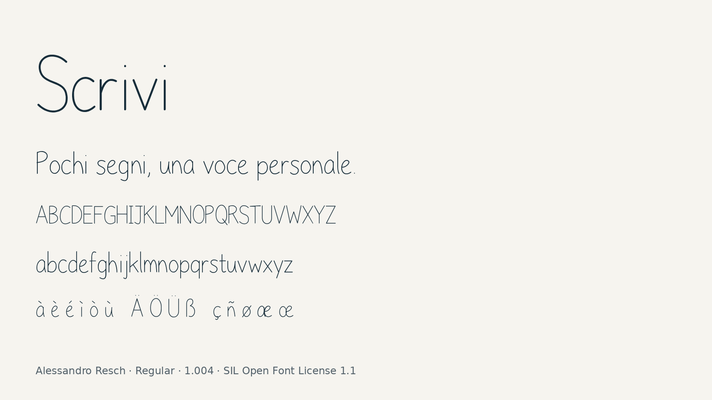

# Scrivi

Author and designer: **Alessandro Resch**.

Scrivi is an original upright monoline handwriting typeface for names, headings
and short messages. Separated letters, compact spacing and restrained flourishes
create a light handwritten rhythm. One style: Regular (400).



## Release 1.004

The family was renamed from AR Scrittura to **Scrivi** on 2 November 2026.
Fontdata's exact-name search found no font named Scrivi on that date:
https://namecheck.fontdata.com/?q=Scrivi
General web searches also found no matching family. These checks do not constitute
trademark clearance. The family/menu name is definitively **Scrivi**, not AR Scrivi.

This release updates naming, copyright URLs, source paths, the site preview and
publishing materials. Binary comparison confirms that outlines, character coverage,
advances, vertical metrics, kerning and mark positioning are unchanged from 1.003.
There are 392 encoded characters and 394 glyphs, including GF Latin Core, ASCII,
Latin-1 Supplement and Latin Extended-A. No Greek, Cyrillic or Arabic coverage is
claimed. Selected kerning, dotless substitutions, mark and mark-to-mark positioning
are included. The font is intended for expressive short text, not as a universal
interface or long-form reading font.

## Installation and web use

Install `fonts/ttf/Scrivi-Regular.ttf` on the desktop. Copy `fonts/webfonts/` and
`web/scrivi.css` while preserving their relative paths for local web hosting.
Use `font-family: 'Scrivi', cursive; font-weight: 400; font-synthesis: none;`.
`Anteprima.html` uses local assets. `Scrivi.html` embeds the webfont and can be
uploaded alongside `Scrivi-1.004-Pubblico.zip` as a standalone download page.

## Reproducible build

Use Python 3.12 in an isolated environment:

```sh
python -m pip install -r requirements-qa.txt
make build
make check
python -m fontbakery check-googlefonts fonts/ttf/Scrivi-Regular.ttf --timeout 5 -j -F --json qa/fontbakery-googlefonts.json --html qa/fontbakery-googlefonts.html
python -m fontbakery check-universal fonts/ttf/Scrivi-Regular.ttf --timeout 5 -j -F --json qa/fontbakery-universal.json --html qa/fontbakery-universal.html
```

Without Make, run `bash sources/build.sh`. Set `PYTHON` to the environment's Python
when necessary. The original stroke source is `sources/glyphs.json`; the build
expands those drawings, exports `sources/Scrivi-Regular.ufo` and compiles it through
fontmake. Regenerating the UFO overwrites direct editor changes; preserve such
changes in a separate copy or incorporate them into the original drawing source.
Build timestamps are fixed for reproducibility. Third-party build tools retain
their own licenses. No external font outlines are copied or embedded.

## Quality assurance and Google Fonts

Full current profile reports, regression checks and the warning review are in `qa/`.
SKIP results are not passed checks. No checks were excluded or suppressed.
The repository follows the essential upstream structure documented by Google:
separate font formats, source UFO and build.sh, documentation, author and license
files, root requirements and an image in this README. A config.yaml and the exact
project-template automation are not mandatory when build.sh supplies the build.

Public repository: https://github.com/r1zr7/scrivi
Google Fonts request: https://github.com/google/fonts/issues/11207
Catalog admission, the author's personal CLA and remaining editorial decisions are
pending. A technical PASS does not constitute admission. The proposed vendor ID
ARSC is retained as a vendor identifier, not part of the family name; it is not
registered with Microsoft. Other residual warnings are described in
`qa/WARN-REVIEW.txt`.

## AI assistance

ChatGPT/Codex assisted drawing construction, font engineering, build scripts,
testing, documentation and release preparation. Alessandro Resch directed the
design decisions and reviewed the visual specimens.

## License

Font software and source scripts: SIL Open Font License 1.1, no Reserved Font Name.
See `OFL.txt`. Author: Alessandro Resch. No reserved AR monogram is included.
New promotional artwork in `documentation/article/scrivi-specimen.png` is licensed
under CC BY-SA 4.0; see `documentation/image-license.txt`. Historical specimens
retain their previously supplied OFL terms.
